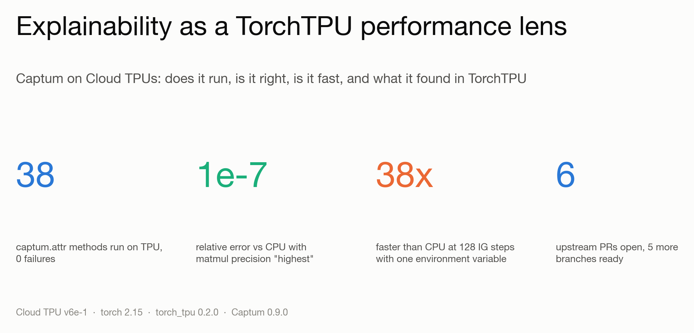
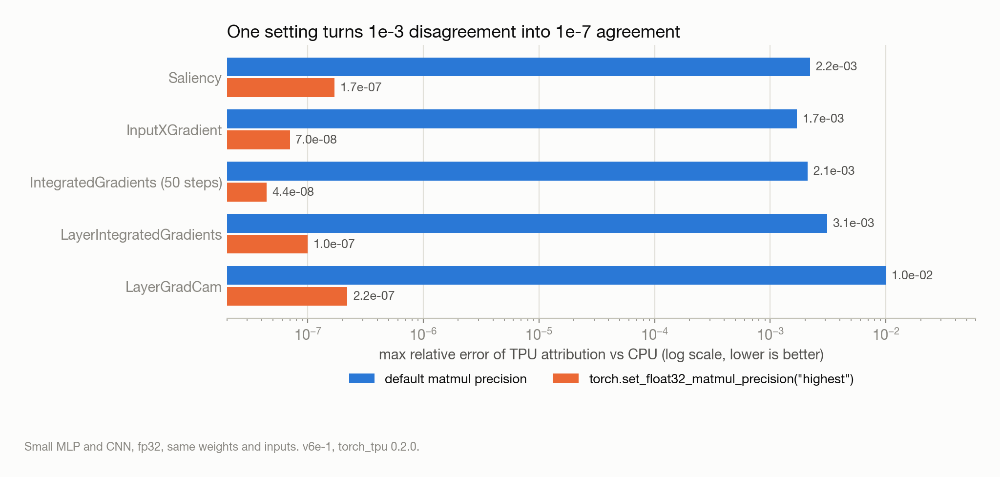
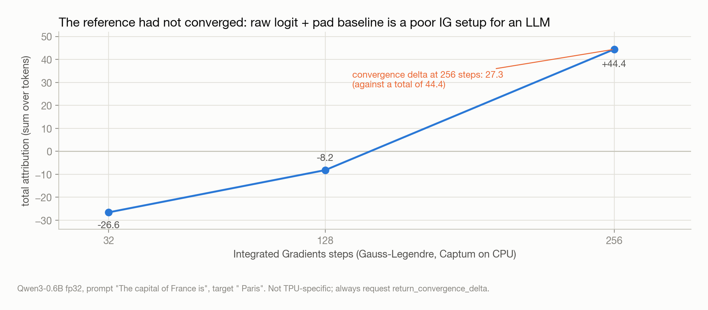
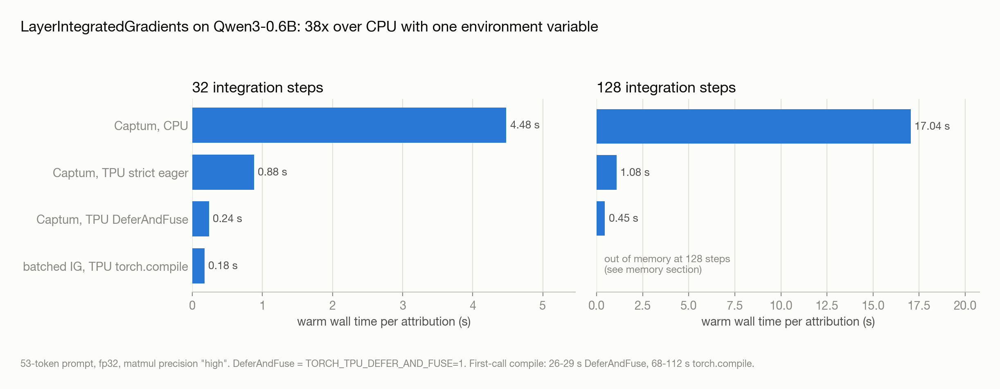
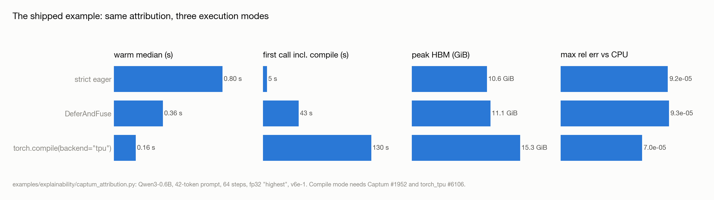
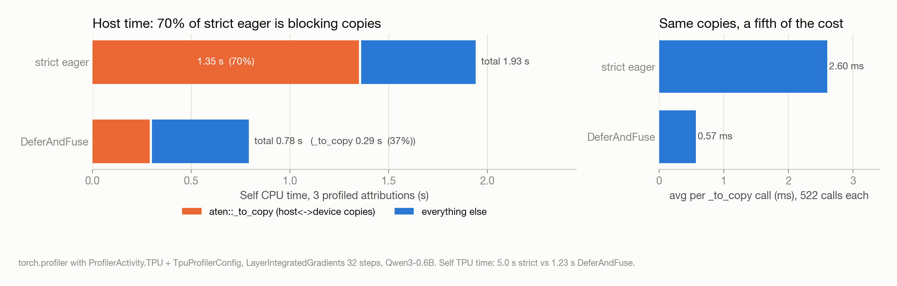
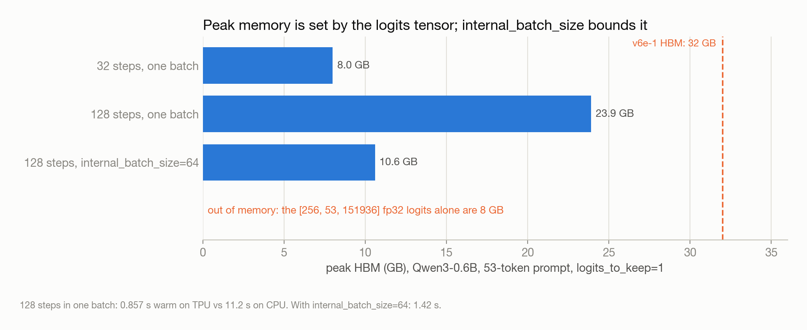
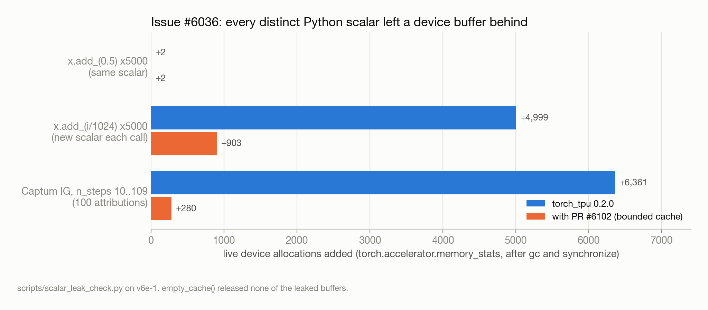
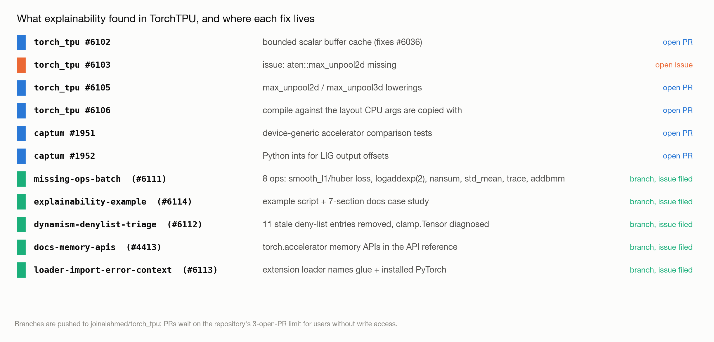

# Running Captum on Cloud TPUs with TorchTPU: correctness, execution modes, and what we fixed upstream



*All measurements were taken on a Cloud TPU v6e-1 in us-east5-b with torch 2.15.0, torch_tpu 0.2.0, Captum 0.9.0 and transformers 5.22.1 unless stated otherwise. Code, scripts and raw findings are in [github.com/joinalahmed/captum-on-torchtpu](https://github.com/joinalahmed/captum-on-torchtpu); the "Where everything lives" section at the end lists them.*

---

## Summary

- Captum runs on TorchTPU without modification. Every public `captum.attr` method, including the `LLMAttribution` wrappers, works on `torch.device("tpu")`. The 27 deterministic methods match CPU to about 1e-7 relative error; the 11 stochastic methods run and differ from CPU only through random sampling.
- Attribution results depend on the matmul precision setting. With the default, TPU attributions differ from CPU by roughly 1e-3 (1e-2 for LayerGradCam). With `torch.set_float32_matmul_precision("highest")` they agree to about 1e-7 on small models and 1e-5 on Qwen3-0.6B. The setting has no measurable cost for this workload.
- Attribution is a useful workload for comparing execution modes. On Qwen3-0.6B, Layer Integrated Gradients with 64 steps takes 0.80 s in strict eager mode, 0.36 s with DeferAndFuse, and 0.16 s under `torch.compile(backend="tpu")`. The same computation on CPU takes between 4 and 17 s depending on the number of steps.
- Working through this surfaced several TorchTPU issues: a leak of device buffers for Python scalars, a missing `max_unpool2d` lowering, a compiled-mode bug that read CPU view arguments past their buffer, a Captum bug that placed a CPU tensor in the compiled graph, eight unregistered ops, and 11 stale entries on the bounded-dynamism deny list. Five pull requests are open upstream. Five more branches are pushed and tracked by issues while the repository's limit of three open PRs per outside contributor frees up.
- On a four-chip v6e-4 the same results hold, and every fix passes the bazel tests upstream CI runs and the matching pytest files. A device-side trace of one attribution call shows why eager mode is slow at small sizes: 363 XLA programs per call, a 2% TensorCore duty cycle, and half of the device op time spent splitting 64-bit Python scalars. Multi-chip attribution is one worker per chip under torchrun; sharding Integrated Gradients across four chips matches the single-chip result to 5.6e-8 and pays off only once the step count no longer fits one chip (1.67x at 256 steps, slower at 64).

---

## 1. Why use explainability to study TorchTPU

Getting good performance from a TPU with plain PyTorch requires understanding TorchTPU's execution modes, its numerical precision defaults, and how to read an XProf profile. We used attribution methods as the workload for studying these because they are compact, repeatable, and representative of code that many teams run.

Integrated Gradients interpolates between a baseline and the input over `n_steps` points, runs a forward and backward pass at each point, and integrates the gradients. This exercises several things at once:

- repeated forward and backward passes with identical shapes, which a compiler can exploit;
- Python scalars (step sizes, scaling factors) flowing into device operations, which exercises eager dispatch and caching;
- forward hooks and `torch.autograd.grad` on intermediate layers, which exercises the autograd integration;
- outputs that are differences of gradients, which makes relative error in the underlying arithmetic visible.

There was also no existing work to build on. A survey of Captum, SHAP, Inseq, TransformerLens, nnsight and pyvene (the report is in `reports/`) found no TPU support statements, no TPU CI, and no TPU-related issues or pull requests in any of them. Captum has around 355k downloads per month and runs CI on CPU and GPU only.

---

## 2. Compatibility

### Primitives

We started with a smoke test (`scripts/tpu_smoke.py`) covering the autograd features attribution methods rely on, using small models so that any failure would come from the runtime rather than from memory limits.

| Primitive | Result on TPU |
|---|---|
| `loss.backward()` | pass |
| `torch.autograd.grad` with respect to inputs | pass |
| forward hooks | pass |
| full backward hooks | pass |
| double backward (`create_graph=True`) | pass |
| custom `autograd.Function` | pass |
| `torch.func.grad` | pass |
| `torch.compile(backend="tpu")` with backward on a view input | pass |
| Captum `IntegratedGradients` | pass |
| Captum `LayerIntegratedGradients` | pass |

All twelve checks pass. `torch.accelerator.current_accelerator()` returns `tpu`, `is_available()` returns true and `device_count()` returns 1, so TorchTPU is registered through the standard accelerator interface and Captum does not need device-specific code.

### Every `captum.attr` method

`scripts/captum_tpu_matrix.py` runs each `captum.attr` class on an MLP and a small CNN, on CPU and on TPU, with matmul precision set to "highest", and compares the outputs.

- 27 methods match CPU within 1e-7 to 1e-8 relative error: IntegratedGradients, Saliency, InputXGradient, DeepLift, GuidedBackprop, Deconvolution, GuidedGradCam, FeatureAblation, Occlusion, ShapleyValues, LRP, and all Layer* and Neuron* variants including LayerGradCam, LayerLRP, LayerFeatureAblation and NeuronConductance.
- 11 methods run but do not match bit for bit: GradientShap, ShapleyValueSampling, NoiseTunnel and the *Shap family. These sample random noise, and the random streams differ between devices, so a mismatch is expected.
- No method produced a wrong result or failed. The first run failed Lime and KernelShap because `sklearn` was not installed; that is an environment issue, not a TPU one.

### Language models

`scripts/demo_captum_qwen_tpu.py` loads Qwen3-0.6B with `AutoModelForCausalLM.from_pretrained(..., device_map="tpu")`, which places the weights on the device directly (2.9 s). `LayerIntegratedGradients` over the embedding layer, `LLMAttribution(FeatureAblation)` and `LLMGradientAttribution(LayerIntegratedGradients)` all run, and the HTML heatmap renders.

### Other libraries

`scripts/other_xai_libs_tpu.py` checks a few other packages. SHAP's DeepExplainer and GradientExplainer, pytorch-grad-cam's GradCAM and ScoreCAM, and nnsight's trace with `device_map="tpu"` all work. Inseq fails with `ValueError: Unknown device tpu` because of a hard-coded device list, which is a small upstream fix. TransformerLens fails on an incompatibility with transformers v5 that is unrelated to TPUs.

---

## 3. Numerical agreement with CPU

By default TorchTPU executes float32 matmuls with bfloat16 inputs on the MXU. Model outputs are generally tolerant of this. Attributions are less so, because they are differences of gradients, and a difference magnifies the relative error of its terms. The table shows the maximum relative error of the TPU attribution against the CPU attribution for the same weights and inputs, on the small MLP and CNN.

| Method | Default precision | `torch.set_float32_matmul_precision("highest")` |
|---|---|---|
| Saliency | 2.2e-3 | 1.7e-7 |
| InputXGradient | 1.7e-3 | 7.0e-8 |
| IntegratedGradients (50 steps) | 2.1e-3 | 4.4e-8 |
| LayerIntegratedGradients | 3.1e-3 | 1.0e-7 |
| LayerGradCam | 1.0e-2 | 2.2e-7 |
| GradientShap | 3.6e-2 | 2.5e-2 (stochastic) |



On Qwen3-0.6B in fp32 with precision "highest", Captum's `LayerIntegratedGradients` on the prompt "The capital of France is" with target " Paris" has a maximum relative error of 8.5e-6 against CPU, and the same three top-attributed tokens (" France", " of", "The").

The "highest" setting costs little for this workload. On Qwen3-0.6B at 32 and 128 steps, warm eager times were 0.86 s and 1.17 s at "highest" compared with 0.88 s and 1.08 s at "high". At this model size the workload is bound by dispatch and host-device traffic rather than by the MXU, as the profiles in section 5 show. We recommend setting "highest" for any attribution work.

### A note on convergence

Early in the project we wrote a batched Integrated Gradients implementation (`torchtpu_xai`) on the assumption that running all steps as one fixed-shape call would be faster than Captum on TPU. Two things came out of this.

First, Captum already works this way. When `internal_batch_size` is None, `IntegratedGradients` expands the input to `n_steps × batch` and runs a single forward and backward pass. Our timings matched Captum's, and we dropped the separate implementation.

Second, our implementation disagreed with Captum by 0.71 relative error on Qwen3. The cause was the integration rule, not a bug: Captum defaults to Gauss-Legendre quadrature while ours used a right Riemann sum, and with `method="riemann_right"` the two agreed to the printed digit. Checking this showed that the reference itself had not converged. Captum on CPU with 256 Gauss-Legendre steps reported a convergence delta of 27.3 against a total attribution of 44.4, and the total moved from -26.6 to -8.2 to +44.4 across 32, 128 and 256 steps. A raw-logit target with a pad-token baseline is not a well-conditioned Integrated Gradients setup for a language model. The practical consequence, which went into the docs, is to request `return_convergence_delta=True` and check it before using an attribution.



---

## 4. Execution modes

TorchTPU offers three ways to run a program: strict eager mode, where each operation is dispatched as it is called; DeferAndFuse, enabled with `TORCH_TPU_DEFER_AND_FUSE=1`, where operations are deferred and fused into larger programs; and `torch.compile(backend="tpu")`. Attribution exercises the differences between them more than a single forward pass does.

### Qwen3-0.6B, 53-token prompt, Captum `LayerIntegratedGradients`, precision "high"

| Steps | Captum, CPU | Captum, TPU strict eager | Captum, TPU DeferAndFuse | Batched IG, `torch.compile` |
|---|---|---|---|---|
| 32 | 4.48 s | 0.880 s | 0.238 s (first call 26 s) | 0.176 s (first call 68 to 112 s) |
| 128 | 17.04 s | 1.078 s | 0.450 s (first call 29 s) | out of memory (see section 5) |



With DeferAndFuse, unmodified Captum runs 3.7 times faster than in strict eager mode and 38 times faster than on CPU at 128 steps. The cost is a fusion compile of 26 to 29 s on the first call.

### The shipped example: Qwen3-0.6B, 42-token prompt, 64 steps, precision "highest"

These are the numbers behind `examples/explainability/captum_attribution.py` on the torch_tpu branch and the docs case study.

| Mode | Warm median | First call | Max rel. error vs CPU | Peak HBM |
|---|---|---|---|---|
| strict eager | 0.80 s | 5 s | 9.2e-05 | 10.6 GiB |
| DeferAndFuse | 0.36 s | 43 s | 9.3e-05 | 11.1 GiB |
| `torch.compile(backend="tpu")` | 0.16 s | 130 s | 7.0e-05 | 15.3 GiB |



On a small MLP the three modes take 0.065, 0.039 and 0.062 s, with 2e-7 relative error in each. Compiled mode only pays off once there is enough work per call to amortize the launch overhead.

Some context for these numbers:

- First-call time matters in practice. TorchTPU's tier-2 compilation cache is disabled for single-device programs, so each new process recompiles. The tier-3 cache (`TORCH_TPU_TIER3_COMPILATION_CACHE_ROOT=gs://...`) persists compiled programs across processes.
- The compiled row required two fixes. Out of the box, Captum's `LayerIntegratedGradients` around a compiled Hugging Face model fails with "expected tensor to be on tpu, got cpu". Section 6 describes the two causes, one in Captum and one in torch_tpu.
- At small sizes, TPU time does not scale with steps. On a 5-token prompt, TPU time was about 0.55 s whether we ran 8, 32 or 64 steps, which indicates fixed overhead rather than compute. The differences between modes become visible at tens of tokens and tens of steps.

---

## 5. Profiling with XProf

We profiled `LayerIntegratedGradients` with 32 steps in each mode using `torch.profiler` with `ProfilerActivity.TPU` and `TpuProfilerConfig` (`scripts/profile_ig_modes.py`), and opened the traces in XProf.

| Mode | Self CPU total | `aten::_to_copy` | `_to_copy` calls | Average per copy | Self TPU total |
|---|---|---|---|---|---|
| strict eager | 1.93 s | 1.35 s (70%) | 522 | 2.6 ms | 5.0 s |
| DeferAndFuse | 0.78 s | 0.29 s | 522 | 0.57 ms | 1.23 s |



In strict eager mode, 70% of host time is spent in `aten::_to_copy`, that is, in host-to-device and device-to-host copies that block the Python thread. Captum moves scalars and small tensors across the host-device boundary frequently: step sizes, the scaling of inputs along the integration path, and the `cumsum` offsets used to slice layer outputs. In strict eager mode each of these is a synchronous round trip. DeferAndFuse performs the same number of copies, but each costs about a fifth as much, because a copy no longer waits for each preceding operation to complete individually.

This is why the docs case study is called "Explainability as a performance lens": attribution is small enough to profile in minutes, and the differences between execution modes show up clearly in a single operator table.

### The device side of the same picture

A trace of one warm 50-step `IntegratedGradients` call on the small MLP, captured on one chip of the v6e-4 with `torch_tpu._internal.profiler` and read with the XProf tools, shows what the host-side table implies.

| Metric | Value |
|---|---|
| Profiled window | 23.3 ms |
| XLA programs launched for one call | 363 |
| Gaps between programs (median 57 us) | 22.3 ms, 95.8% of the window |
| TensorCore duty cycle | 2.0% |
| Device op time | 476 us |
| `X64SplitLow` / `X64SplitHigh` custom calls (302) | 231 us, 48.6% of op time |
| The MLP's four matmul fusions | 5.2 us, 0.02% of the window |
| MXU utilization | 0.0% |

Eager TorchTPU dispatches one XLA program per PyTorch op, so an attribution over 50 interpolation points is 363 launches with a median gap of 57 us between them, and the TensorCore is idle for 98% of the call. Half of the device op time goes to `X64SplitLow` and `X64SplitHigh`, the custom calls that split 64-bit Python scalars into two 32-bit halves on arrival; this is the same scalar path as the buffer leak in section 6.1. The matmuls that constitute the model are 5 microseconds. On a model this small, eager attribution is launch-bound from both the host and the device side, and the remedies are the ones in section 4, DeferAndFuse or `torch.compile`, rather than a faster chip. The trace and the full report are in `tpu_agent_project/results/`.

### Memory

Peak HBM is determined by the logits tensor. A language-model attribution materializes `[steps, T, V]` logits before selecting the last position and the target token. For Qwen3 at 128 steps and 53 tokens that is `[128, 53, 151936]` in fp32, 3.84 GB, held alongside the interpolation path and its gradients. This is what ran out of memory for the batched implementation at 128 steps, and for every variant at 256 steps.

Two changes in user code address this:

- `model(input_ids, logits_to_keep=1)` (transformers v5) keeps only the last position. With it, 128 steps in a single batch took 0.857 s warm on TPU (23.9 GB peak) compared with 11.2 s on CPU.
- Captum's `internal_batch_size` splits the steps into chunks. 128 steps with `internal_batch_size=64` took 1.42 s at 10.6 GiB peak, compared with 23.9 GB unchunked.



The `torch.accelerator` memory APIs (`memory_stats`, `max_memory_allocated`, `empty_cache` and related calls) were undocumented for TorchTPU; the `docs-memory-apis` branch adds a section describing what each returns on TPU.

---

## 6. Issues found in TorchTPU and Captum

Each item in this section began as something Captum does that a typical training loop does not.

### 6.1 Device buffers for Python scalars were never released (issue [#6036](https://github.com/google-pytorch/torch_tpu/issues/6036), PR [#6102](https://github.com/google-pytorch/torch_tpu/pull/6102))

Captum's Integrated Gradients scales inputs by a different Python float at each step. An open issue reported that eager-mode device buffers created for distinct Python scalars were never evicted. `scripts/scalar_leak_check.py` reproduces it:

| Loop | Live allocations added after 5000 iterations |
|---|---|
| `x.add_(0.5)` (same scalar each time) | +2 |
| `x.add_(i / 1024)` (new scalar each time) | +4999 |
| after `empty_cache()` | none released |

Captum triggers the same behaviour. Twenty attribution calls with the same `n_steps` added no allocations, but sweeping `n_steps` from 10 to 109 added 6361, because each value of `n_steps` produces a new set of step-size floats.



The fix is a bounded per-thread cache in `MakeBuffer` in `csrc/eager/op_dispatcher.cc`, with a regression test in `tests/scalar_buffer_cache_test.py`. With the patch, the 5000-scalar loop adds 903 allocations (the 1024-entry cache clears four times) and the Captum sweep adds 280. The PR is [google-pytorch/torch_tpu#6102](https://github.com/google-pytorch/torch_tpu/pull/6102).

On current main, the strict-eager case no longer leaks because of a transfer refactor, but DeferAndFuse still does (+5001), so the fix remains relevant.

### 6.2 `aten::max_unpool2d` was not implemented (issue [#6103](https://github.com/google-pytorch/torch_tpu/issues/6103), PR [#6105](https://github.com/google-pytorch/torch_tpu/pull/6105))

We ported Captum's 78 attribution test configurations into a device-generic suite that runs them on CPU and on `CAPTUM_TEST_DEVICE=tpu` and compares the results. Of 266 generated tests, 262 passed and 4 failed, in 5 min 25 s.

One failure was a tolerance miss at a near-zero attribution (+6.1e-5 against -6.1e-5), which is precision noise. The other three were the same gap: DeepLift's MaxPool rule calls `F.max_unpool2d`, and TorchTPU had no lowering for it, so every DeepLift variant on a CNN failed with `RuntimeError: operator 'aten::max_unpool2d' is not implemented for TPU`.

We filed the issue and implemented `max_unpool2d` and `max_unpool3d` as a StableHLO batched scatter. 25 unit tests and 4 error-message tests pass on v6e, and the three DeepLift configurations now pass. The PR is [google-pytorch/torch_tpu#6105](https://github.com/google-pytorch/torch_tpu/pull/6105).

### 6.3 Compiled partitions read CPU view arguments past their buffer (PR [#6106](https://github.com/google-pytorch/torch_tpu/pull/6106))

Reducing the "expected tensor to be on tpu, got cpu" failure under `torch.compile` led to a separate bug: `x * cpu_tensor[1].to(tpu)` under `torch.compile(backend="tpu")` returned zero. A StableHLO dump showed that the TPU partition was compiled against the view's strides and storage offset, while at run time the argument is copied to the device as a contiguous tensor. The compiled program therefore read beyond the buffer it received.

The fix in `split_compiler.py` compiles TPU partitions against the contiguous layout the argument is actually copied with. A test is included, the fix is verified on v6e, and CI is green. The PR is [google-pytorch/torch_tpu#6106](https://github.com/google-pytorch/torch_tpu/pull/6106).

### 6.4 Captum placed a CPU tensor in the compiled graph (Captum PR [#1952](https://github.com/meta-pytorch/captum/pull/1952))

The other cause of the compile failure is in Captum. `LayerIntegratedGradients` computes output offsets with `torch.cumsum` on a CPU tensor and uses the result to slice layer outputs. Under `torch.compile`, that CPU tensor becomes a graph input on the wrong device. Replacing it with Python integers resolves this, and 12 `LayerIntegratedGradients` tests pass on TPU. The PR is [meta-pytorch/captum#1952](https://github.com/meta-pytorch/captum/pull/1952).

With [#1952](https://github.com/meta-pytorch/captum/pull/1952) and [#6106](https://github.com/google-pytorch/torch_tpu/pull/6106) applied, the compiled row in section 4 runs: 0.16 s warm with 7.0e-05 relative error.

### 6.5 Eight unregistered ops (branch `missing-ops-batch`)

`scripts/probe_unregistered_ops.py` runs each ATen op that TorchTPU does not register with a plausible input. From that list we implemented eight with unit tests: `smooth_l1_loss` and `huber_loss` with their backward passes, `logaddexp`, `logaddexp2`, `nansum`, `std_mean`, `trace` and `addbmm`. 53 new tests pass on v6e against a wheel built from the branch; the change is 23 files and 1733 lines.

One constraint shaped the implementation. TorchTPU does not accept new composite kernels: if a `TT_KERNEL` calls another ATen op, `OpNameStack` aborts at run time with `CompositeOpCheck: Op trace is decomposed into as_strided ... implement the trace op by lowering it to SHLO instead`, and the list of permitted composites is capped at 150 entries with a comment not to add more. `nansum`, `trace`, `std_mean` and `addbmm` compiled as composites but failed at run time, and each was rewritten as a direct StableHLO lowering: a diagonal mask and reduction for `trace`; `Select(IsNan(x), 0, x)` followed by a sum for `nansum`; `Sqrt(Var)` and `Mean` on the shared reduction code for `std_mean`; a batched matmul followed by a sum over the batch axis for `addbmm`.

Smaller points for future contributors: `IgnoreInCacheKey` rejects `PromotedScalar` because scalars are already excluded from cache keys; `UnaryOpOptions` has no default constructor, so `.op_param_cache_keys` must be set; and TPU matmul tests need `set_float32_matmul_precision("highest")` to match CPU.

Still unregistered after this batch: `triu_indices`, `median`, `nanmedian`, `mode`, `kthvalue`, `frexp`, `renorm`, and the `.out` variants of roughly a dozen more ops.

### 6.6 Bounded-dynamism deny list (branch `dynamism-denylist-triage`)

TorchTPU's bounded-dynamism tests (`tests/dynamism_test_utils.py`) include a deny list of ops marked "untriaged: invalid result". We removed the skips for 12 of them and ran the eager and compiled dynamic test targets on v6e. On a single-chip host this needs `--local_test_jobs=1`; parallel shards otherwise contend for `/dev/vfio/0`.

Eleven ops pass in both modes: `eq`, `maximum`, `ne`, `neg`, `pow`, `remainder`, `round`, `sign`, `sinh`, `sub` and `trunc`. Their entries are removed. One op has a real defect: `clamp.Tensor` (tensor-valued min and max) mismatches 80% of elements whenever any dimension is bounded, while the scalar variants pass. Its entry is moved to a diagnosed reason with the reproduction conditions.

### 6.7 Smaller items

- Loader error message (branch `loader-import-error-context`): a wheel built from source only imports against the torch version pinned in the repository lockfile, and the failure was a bare `undefined symbol c10::report_overflow`. The versioned extension loader now names the glue library it selected and the PyTorch version it found. A test is included.
- Memory API documentation (branch `docs-memory-apis`, addresses [#4413](https://github.com/google-pytorch/torch_tpu/issues/4413)): the `torch.accelerator` memory APIs are documented in the API reference with values measured on v6e.
- Triage comment on [#4408](https://github.com/google-pytorch/torch_tpu/issues/4408): the reported NaN in compiled SDPA backward does not reproduce on 0.2.0 with torch 2.15 (Qwen3; compiled vs CPU relative error 1.85e-5).
- [#4409](https://github.com/google-pytorch/torch_tpu/issues/4409) (compile with backward on a view input) did not reproduce in our smoke test. This is noted but not yet verified numerically.

---

## 7. Four chips: what changes and what does not

Everything above ran on a single v6e chip. A v6e-4 (four chips on one host, us-east5-b) answers two questions: do the results hold on a multi-chip host, and does splitting an attribution across chips help.

**Process model.** libtpu is exclusive per process. A second process that touches the TPU while one is running fails with "The TPU is already in use by process with pid N". Multi-chip work on TorchTPU is therefore one worker process per chip, launched with torchrun after exporting the slice topology:

```bash
eval $(python -m torch.tpu.distributed | sed 's/^/export /')
torchrun --nproc_per_node=$WORLD_SIZE captum_multichip_ig.py --steps 256
```

Inside a worker, `torch.accelerator.device_count()` is 1 and `torch.device("tpu")` is that worker's chip. The `tpu_dist` backend gives the usual `torch.distributed` collectives.

**Correctness.** The 38-method attribution matrix on chip 0 of the v6e-4 gives the same result as the v6e-1: 27 methods match CPU, 11 stochastic methods run. Sharding Integrated Gradients across the four chips, where each rank evaluates a quarter of the Riemann grid in one batched forward and backward pass and an `all_reduce` assembles the attribution, reproduces Captum's single-chip `LayerIntegratedGradients` to a relative error of 5.6e-8 when both sides use the same batch size, and 1.2e-4 when they do not (the matmul reduction order differs, as in section 3).

**Speed.** Qwen3-0.6B, fp32, 53 tokens, strict eager, released wheel:

| n_steps | 4 chips, sharded | 1 chip, Captum | speedup |
|---|---|---|---|
| 64 | 0.355 s | 0.219 s (all 64 in one batch) | 0.62x |
| 256 | 0.327 s | 0.547 s (`internal_batch_size=64`) | 1.67x |
| 256 | 0.357 s | out of memory in a single batch | - |

At 64 steps one chip finishes the whole batch in a fifth of a second, and splitting it four ways costs more in dispatch and all-reduce than it saves. At 256 steps a single chip cannot hold the batch (the same out-of-memory failure as on the v6e-1), Captum has to chunk it into four sequential pieces, and the four chips run those pieces in parallel. The gain is 1.67x rather than 4x because per-chunk fixed costs and the all-reduce are not amortised at this size. Multi-chip attribution pays off when the step count or the model pushes a single chip past its memory, not before.

**The fixes on four chips.** Each branch was rebuilt from source on the 4-chip host and run through the same bazel targets upstream CI uses, with the `_tpu-v6e` variant, plus the corresponding pytest files against the installed wheel: the bounded scalar cache test passes, and a four-worker torchrun of the leak check gives every rank the same counts as the single chip; the `max_unpool`, eight-op and eleven-op dynamic tests pass; the split-compile test for the CPU view argument passes; the loader test passes; the memory APIs return per-process values; the shipped example runs in all three modes at a relative error of 2.0e-7 against CPU. Raw logs are in the repository under `results/v6e-4/`.

**What was not covered.** The v5e-8 that upstream CI runs on, and the distributed test suite under `tests/distributed/`, were out of reach: v5e capacity in the project's zones was unavailable all day and a v5litepod-8 exceeds the project's 4-chip per-zone serving quota. One operational note: partway through, the host-side TPU session manager on the first v6e-4 started refusing every process (`tpunetd START_SESSION failed`), which neither a guest reboot nor a runtime restart cleared. Queued-resource nodes cannot be stopped and started, so the fix was to delete the node and queue a new one with the same persistent build disk attached. The bazel cache on that disk brought the replacement from bare image to the first branch test in under 20 minutes.

---

## 8. What this adds to TorchTPU and Captum

The `explainability-example` branch adds to torch_tpu:

- `examples/explainability/captum_attribution.py`: a single script with flags for the model (`tiny` or any Hugging Face causal LM), steps, runs, precision, `--compile`, `--internal-batch-size` and `--profile-dir`. It reports CPU reference time, first-call time, warm median, maximum relative error against CPU and peak HBM.
- `docs/source/case_studies_explainability.py` and its Markdown export: a seven-section case study covering running Captum on a TPU, setting the matmul precision, comparing execution modes, reading the XProf trace, bounding peak memory, checking convergence, and running the example. It is linked from the case-study index and the examples README, and `mkdocs build --strict` passes.

For Captum, `tests/attr/test_accelerator.py` ([meta-pytorch/captum#1951](https://github.com/meta-pytorch/captum/pull/1951)) re-runs Captum's 78 attribution configurations on CPU and on any accelerator and compares the results, so TPU compatibility is covered by tests rather than by this write-up.

---

## 9. Before you try this

- Strict eager and DeferAndFuse work on torch_tpu 0.2.0 as released. Compiled mode needs two patches that are not yet merged (Captum [#1952](https://github.com/meta-pytorch/captum/pull/1952), torch_tpu [#6106](https://github.com/google-pytorch/torch_tpu/pull/6106)). Until they land, DeferAndFuse is the option that requires no changes.
- Five branches (`missing-ops-batch`, `explainability-example`, `dynamism-denylist-triage`, `docs-memory-apis`, `loader-import-error-context`) are pushed to the fork but do not yet have upstream pull requests. The repository allows users without write access three open PRs, and the first three fill that quota. Each branch is tracked by an issue ([#6111](https://github.com/google-pytorch/torch_tpu/issues/6111) to [#6114](https://github.com/google-pytorch/torch_tpu/issues/6114), and a comment on [#4413](https://github.com/google-pytorch/torch_tpu/issues/4413)) so review can begin before the PR exists.

---

## 10. Where everything lives



**Open upstream**

- [google-pytorch/torch_tpu#6102](https://github.com/google-pytorch/torch_tpu/pull/6102): bounded scalar buffer cache (fixes [#6036](https://github.com/google-pytorch/torch_tpu/issues/6036))
- [google-pytorch/torch_tpu#6103](https://github.com/google-pytorch/torch_tpu/issues/6103): issue, `aten::max_unpool2d` missing
- [google-pytorch/torch_tpu#6105](https://github.com/google-pytorch/torch_tpu/pull/6105): `max_unpool2d` / `max_unpool3d` lowerings
- [google-pytorch/torch_tpu#6106](https://github.com/google-pytorch/torch_tpu/pull/6106): fix compiled TPU partitions reading CPU view arguments past their buffer
- [meta-pytorch/captum#1951](https://github.com/meta-pytorch/captum/pull/1951): device-generic accelerator comparison tests
- [meta-pytorch/captum#1952](https://github.com/meta-pytorch/captum/pull/1952): Python ints for LayerIntegratedGradients output offsets

**Pushed, PR pending** (fork [`joinalahmed/torch_tpu`](https://github.com/joinalahmed/torch_tpu); the repository caps users without write access at three open PRs, so each branch is tracked by an issue until a slot frees)

- [`missing-ops-batch`](https://github.com/joinalahmed/torch_tpu/tree/missing-ops-batch): [google-pytorch/torch_tpu#6111](https://github.com/google-pytorch/torch_tpu/issues/6111)
- [`explainability-example`](https://github.com/joinalahmed/torch_tpu/tree/explainability-example): [google-pytorch/torch_tpu#6114](https://github.com/google-pytorch/torch_tpu/issues/6114)
- [`dynamism-denylist-triage`](https://github.com/joinalahmed/torch_tpu/tree/dynamism-denylist-triage): [google-pytorch/torch_tpu#6112](https://github.com/google-pytorch/torch_tpu/issues/6112)
- [`docs-memory-apis`](https://github.com/joinalahmed/torch_tpu/tree/docs-memory-apis): comment on [google-pytorch/torch_tpu#4413](https://github.com/google-pytorch/torch_tpu/issues/4413)
- [`loader-import-error-context`](https://github.com/joinalahmed/torch_tpu/tree/loader-import-error-context): [google-pytorch/torch_tpu#6113](https://github.com/google-pytorch/torch_tpu/issues/6113)

**In this repository** ([joinalahmed/captum-on-torchtpu](https://github.com/joinalahmed/captum-on-torchtpu))

- `blog_captum_torchtpu.md`: this post; figures in `images/`, generated by [`scripts/make_blog_images.py`](https://github.com/joinalahmed/captum-on-torchtpu/blob/main/scripts/make_blog_images.py)
- `FINDINGS.md`: the measurements, in the order they were taken
- `scripts/`: every benchmark, probe and reproduction referenced above, plus `tpu_vm.sh` for creating, setting up and deleting the VM
- `captum_on_torchtpu.ipynb`: notebook version of sections 2 to 5
- `reports/Explainability tools on TPUs.md`: the prior-art survey
- `results/v6e-4/`: the four-chip attribution matrix, the sharded IG numbers and every branch's multi-chip test log
- `tpu_agent_project/` and `blog_explainability_agent_assisted.md`: the same workload dispatched through Google's TPU agent suite, with the XProf report quoted in section 5

**Cost.** The single-chip work ran on a v6e-1 created and deleted per work session; the four-chip section ran on one v6e-4 obtained through a queued resource after several hours of waiting for capacity. Both the VMs and their disks are billed while they exist; everything was deleted when the work finished.

---

*Written with Claude Code as the pair programmer. Commits in torch_tpu carry an `Assisted-by` trailer, as that project's contributing guide requests; AI is not listed as a co-author there.*
