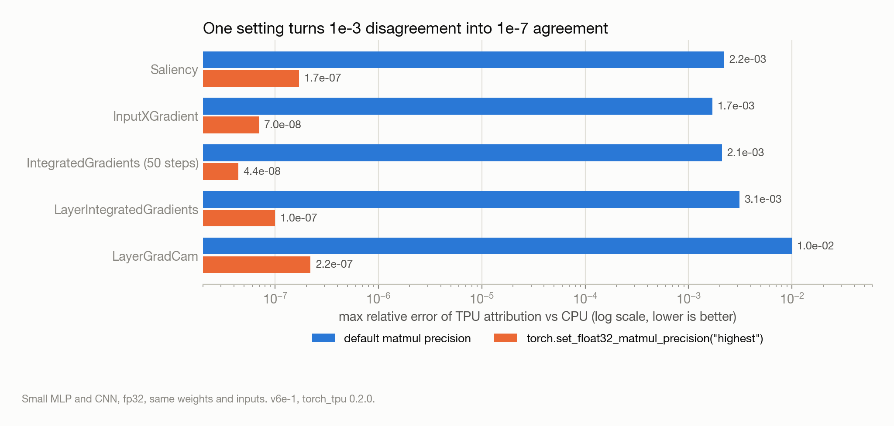
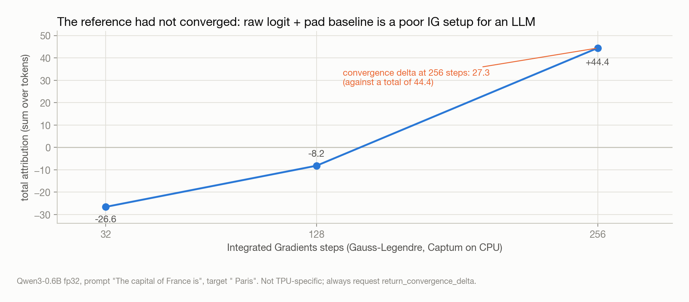
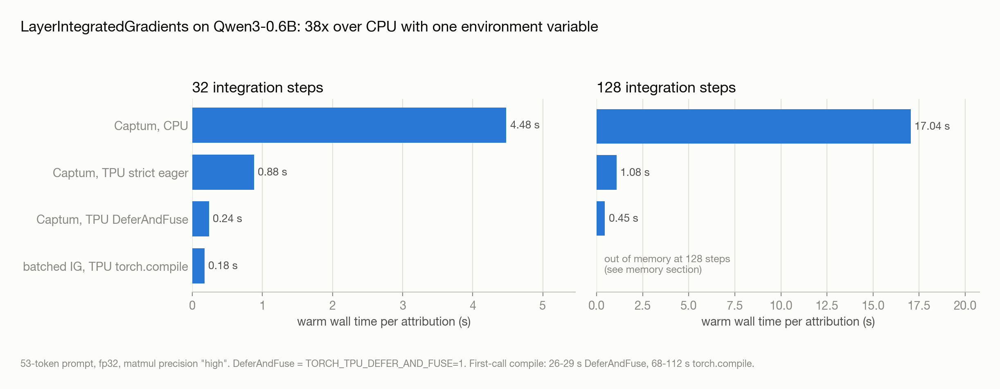
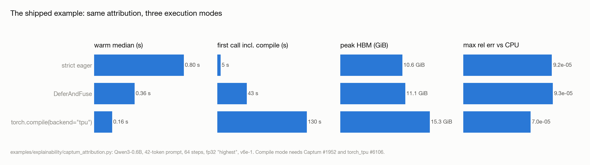
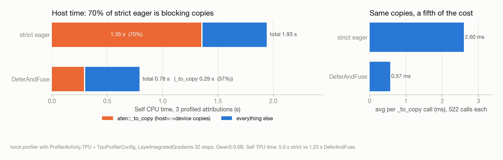
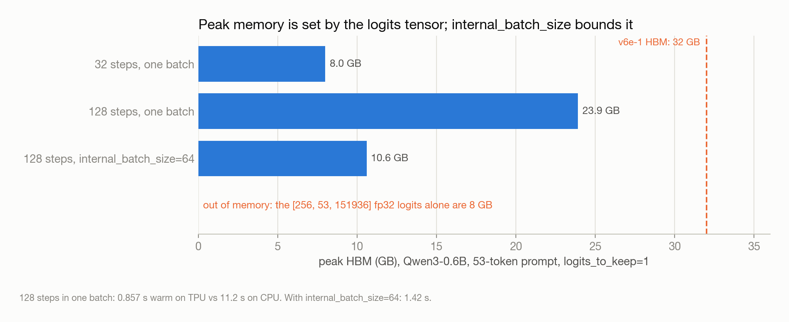
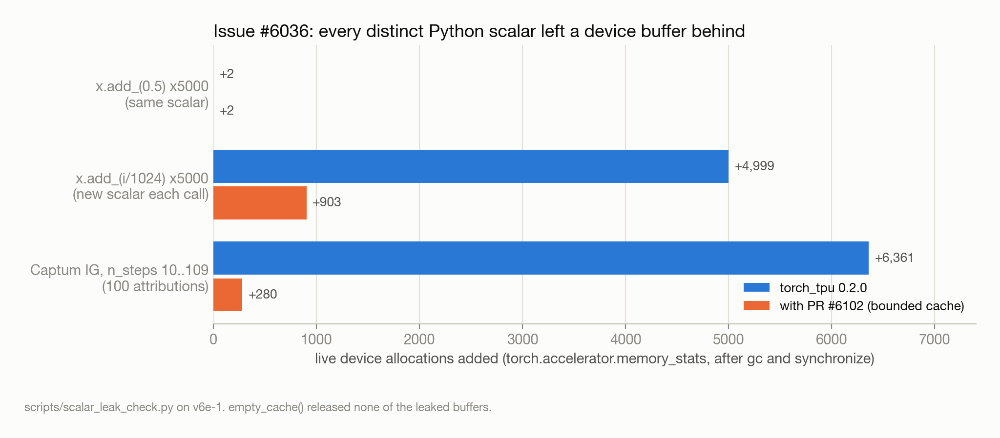
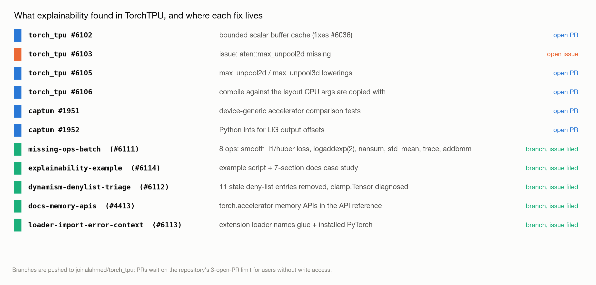

*This is the log of a few days spent running Captum's attribution methods on Cloud TPUs through TorchTPU, in the order the work happened, with what I learned at each step. Unless stated otherwise, measurements are from a Cloud TPU v6e-1 in us-east5-b with torch 2.15.0, torch_tpu 0.2.0, Captum 0.9.0 and transformers 5.22.1. Code, scripts and raw findings are in [github.com/joinalahmed/captum-on-torchtpu](https://github.com/joinalahmed/captum-on-torchtpu); the last section lists them.*

---

## What I ended up with

Before the log, the short version:

- Captum works on TorchTPU without modification. Every public `captum.attr` method, including the `LLMAttribution` wrappers, runs on `torch.device("tpu")`. The 27 deterministic methods match CPU to about 1e-7 relative error; the 11 stochastic ones run and differ only through random sampling.
- The one setting that matters for correctness is matmul precision. At the default, TPU attributions differ from CPU by about 1e-3 (1e-2 for LayerGradCam). With `torch.set_float32_matmul_precision("highest")` they agree to 1e-7 on small models and 1e-5 on Qwen3-0.6B, at no measurable cost for this workload.
- Attribution turned out to be a good lens on TorchTPU's execution modes. On Qwen3-0.6B, Layer Integrated Gradients with 64 steps takes 0.80 s in strict eager mode, 0.36 s with DeferAndFuse and 0.16 s under `torch.compile(backend="tpu")`, against 4 to 17 s on CPU.
- Along the way I hit, and fixed or filed, a buffer leak for Python scalars, a missing `max_unpool2d` lowering, a compiled-mode bug that read CPU view arguments past their buffer, a Captum bug that placed a CPU tensor in the compiled graph, eight unregistered ops and 11 stale deny-list entries. Five pull requests are open upstream; five more branches wait on a PR-count limit.
- On a four-chip v6e-4 everything held, every fix passed the tests upstream CI runs, and a device-side trace explained the eager-mode numbers: 363 XLA programs per attribution call and a 2% TensorCore duty cycle.

The rest is how I got there.

---

## 1. Starting point: why attribution, and what already existed

I wanted a workload that would exercise TorchTPU's execution modes, its numerical defaults and its profiler, and that was small enough to iterate on quickly. Attribution fit. Integrated Gradients interpolates between a baseline and the input over `n_steps` points, runs a forward and backward pass at each point and integrates the gradients, which means:

- repeated forward and backward passes with identical shapes, which a compiler can exploit;
- Python scalars (step sizes, scaling factors) flowing into device operations, which exercises eager dispatch and caching;
- forward hooks and `torch.autograd.grad` on intermediate layers, which exercises the autograd integration;
- outputs that are differences of gradients, which make arithmetic error visible.

The first thing I did was check whether anyone had done this. A survey of Captum, SHAP, Inseq, TransformerLens, nnsight and pyvene (the report is in `reports/`) found no TPU support statements, no TPU CI and no TPU-related issues or pull requests in any of them. Captum has around 355k downloads a month and runs CI on CPU and GPU only.

**Learned:** there was no prior art to lean on, which meant every result below needed its own CPU comparison rather than a reference I could cite.

---

## 2. Does anything run at all

I started with a smoke test (`scripts/tpu_smoke.py`) covering the autograd features attribution methods depend on, on deliberately small models so that any failure would come from the runtime and not from memory.

| Primitive | Result on TPU |
|---|---|
| `loss.backward()` | pass |
| `torch.autograd.grad` with respect to inputs | pass |
| forward hooks | pass |
| full backward hooks | pass |
| double backward (`create_graph=True`) | pass |
| custom `autograd.Function` | pass |
| `torch.func.grad` | pass |
| `torch.compile(backend="tpu")` with backward on a view input | pass |
| Captum `IntegratedGradients` | pass |
| Captum `LayerIntegratedGradients` | pass |

All twelve passed. `torch.accelerator.current_accelerator()` returned `tpu`, `is_available()` true, `device_count()` 1.

Encouraged, I wrote `scripts/captum_tpu_matrix.py` to run every `captum.attr` class on an MLP and a small CNN, on CPU and on TPU, and compare the outputs.

- 27 methods matched CPU within 1e-7 to 1e-8: IntegratedGradients, Saliency, InputXGradient, DeepLift, GuidedBackprop, Deconvolution, GuidedGradCam, FeatureAblation, Occlusion, ShapleyValues, LRP and all the Layer* and Neuron* variants.
- 11 ran but did not match bit for bit: GradientShap, ShapleyValueSampling, NoiseTunnel and the *Shap family. They sample random noise and the streams differ between devices, so that is expected.
- Nothing failed for a TPU reason. Lime and KernelShap failed on the first run because `sklearn` was not installed.

Then a real model. `scripts/demo_captum_qwen_tpu.py` loads Qwen3-0.6B with `AutoModelForCausalLM.from_pretrained(..., device_map="tpu")`, which puts the weights on the device directly (2.9 s). `LayerIntegratedGradients` over the embedding layer, `LLMAttribution(FeatureAblation)` and `LLMGradientAttribution(LayerIntegratedGradients)` all ran and the HTML heatmap rendered.

For completeness I tried a few other libraries (`scripts/other_xai_libs_tpu.py`). SHAP's DeepExplainer and GradientExplainer, pytorch-grad-cam's GradCAM and ScoreCAM, and nnsight's trace with `device_map="tpu"` all worked. Inseq failed with `ValueError: Unknown device tpu` from a hard-coded device list, a small upstream fix. TransformerLens failed on a transformers v5 incompatibility unrelated to TPUs.

**Learned:** TorchTPU registers through the standard accelerator interface, so a library that is device-agnostic in the PyTorch sense needs no TPU-specific code. The failures I did see were allow-lists, not kernels.

---

## 3. The numbers were off by 1e-3, and why

The matrix above was run with matmul precision set to "highest". My first pass had used the default, and the agreement was much worse. That turned into the single most useful finding of the project.

By default TorchTPU runs float32 matmuls with bfloat16 inputs on the MXU. Model outputs tolerate this. Attributions do not, because they are differences of gradients and a difference magnifies the relative error of its terms.

| Method | Default precision | `torch.set_float32_matmul_precision("highest")` |
|---|---|---|
| Saliency | 2.2e-3 | 1.7e-7 |
| InputXGradient | 1.7e-3 | 7.0e-8 |
| IntegratedGradients (50 steps) | 2.1e-3 | 4.4e-8 |
| LayerIntegratedGradients | 3.1e-3 | 1.0e-7 |
| LayerGradCam | 1.0e-2 | 2.2e-7 |
| GradientShap | 3.6e-2 | 2.5e-2 (stochastic) |



On Qwen3-0.6B in fp32 at "highest", `LayerIntegratedGradients` on "The capital of France is" with target " Paris" came within 8.5e-6 of CPU and gave the same three top-attributed tokens (" France", " of", "The").

I expected "highest" to cost something. It did not, measurably: on Qwen3 at 32 and 128 steps the warm eager times were 0.86 s and 1.17 s at "highest" versus 0.88 s and 1.08 s at "high". The profiles in section 5 explain why: at this model size the workload is bound by dispatch and host-device traffic, not the MXU.

**Learned:** set `torch.set_float32_matmul_precision("highest")` before any attribution work on TPU. It is the difference between 1e-3 and 1e-7, and for this workload it is free.

---

## 4. A detour: my own batched IG, and a reference that had not converged

Early on I assumed that Captum would be slow on TPU because it loops, and wrote a batched Integrated Gradients (`torchtpu_xai`) that runs all steps as a single fixed-shape call. Two things came out of that.

First, Captum already does this. With `internal_batch_size=None`, `IntegratedGradients` expands the input to `n_steps × batch` and runs one forward and backward. My timings matched Captum's, and I dropped the separate implementation.

Second, my implementation disagreed with Captum by 0.71 relative error on Qwen3, which took a while to understand. It was not a bug. Captum defaults to Gauss-Legendre quadrature and I had used a right Riemann sum; with `method="riemann_right"` the two agreed to the printed digit. Checking that, though, showed the reference itself had not converged: Captum on CPU with 256 Gauss-Legendre steps reported a convergence delta of 27.3 against a total attribution of 44.4, and the total moved from -26.6 to -8.2 to +44.4 across 32, 128 and 256 steps. A raw-logit target with a pad-token baseline is simply not a well-conditioned IG setup for a language model.



**Learned:** before comparing two attribution implementations, check that the thing being compared has converged. `return_convergence_delta=True` is cheap, and I put that advice into the docs I later contributed. Also: read the library before reimplementing it.

---

## 5. Execution modes, with attribution as the probe

TorchTPU has three ways to run a program: strict eager, where each op is dispatched as called; DeferAndFuse (`TORCH_TPU_DEFER_AND_FUSE=1`), where ops are deferred and fused into larger programs; and `torch.compile(backend="tpu")`. Attribution exposes the differences more than a single forward pass does.

### Qwen3-0.6B, 53-token prompt, Captum `LayerIntegratedGradients`, precision "high"

| Steps | Captum, CPU | Captum, TPU strict eager | Captum, TPU DeferAndFuse | Batched IG, `torch.compile` |
|---|---|---|---|---|
| 32 | 4.48 s | 0.880 s | 0.238 s (first call 26 s) | 0.176 s (first call 68 to 112 s) |
| 128 | 17.04 s | 1.078 s | 0.450 s (first call 29 s) | out of memory (see section 6) |



With DeferAndFuse, unmodified Captum ran 3.7 times faster than strict eager and 38 times faster than CPU at 128 steps, for a one-time fusion compile of 26 to 29 s.

### The shipped example: Qwen3-0.6B, 42-token prompt, 64 steps, precision "highest"

These are the numbers behind the example I later added to torch_tpu (`examples/explainability/captum_attribution.py`).

| Mode | Warm median | First call | Max rel. error vs CPU | Peak HBM |
|---|---|---|---|---|
| strict eager | 0.80 s | 5 s | 9.2e-05 | 10.6 GiB |
| DeferAndFuse | 0.36 s | 43 s | 9.3e-05 | 11.1 GiB |
| `torch.compile(backend="tpu")` | 0.16 s | 130 s | 7.0e-05 | 15.3 GiB |



On a small MLP the three modes take 0.065, 0.039 and 0.062 s with 2e-7 error each, so compiled mode only pays off once there is enough work per call to amortise the launch.

Three things I had to learn the hard way here:

- First-call time is real. TorchTPU's tier-2 compilation cache is off for single-device programs, so each new process recompiles. The tier-3 cache (`TORCH_TPU_TIER3_COMPILATION_CACHE_ROOT=gs://...`) persists compiled programs across processes.
- The compiled column did not work out of the box. Captum's `LayerIntegratedGradients` around a compiled Hugging Face model failed with "expected tensor to be on tpu, got cpu". Section 7 covers the two causes, one in Captum and one in torch_tpu.
- At small sizes TPU time does not scale with steps. On a 5-token prompt it was about 0.55 s whether I ran 8, 32 or 64 steps. That is fixed overhead, and the differences between modes only show at tens of tokens and tens of steps.

**Learned:** for an unmodified Captum workload, DeferAndFuse is the setting that gives most of the speed-up with no code changes. Compile is faster still but needs patches and a long first call.

---

## 6. Profiling: where the time actually goes

I profiled `LayerIntegratedGradients` at 32 steps in each mode with `torch.profiler`, `ProfilerActivity.TPU` and `TpuProfilerConfig` (`scripts/profile_ig_modes.py`), and opened the traces in XProf.

| Mode | Self CPU total | `aten::_to_copy` | `_to_copy` calls | Average per copy | Self TPU total |
|---|---|---|---|---|---|
| strict eager | 1.93 s | 1.35 s (70%) | 522 | 2.6 ms | 5.0 s |
| DeferAndFuse | 0.78 s | 0.29 s | 522 | 0.57 ms | 1.23 s |



In strict eager mode 70% of host time is `aten::_to_copy`: host-to-device and device-to-host copies that block the Python thread. Captum crosses the boundary constantly, for step sizes, for the scaling of inputs along the path, for the `cumsum` offsets it uses to slice layer outputs. Each is a synchronous round trip in eager mode. DeferAndFuse does the same 522 copies but each costs a fifth as much, because a copy no longer waits for every preceding op individually.

### The same picture from the device side

Later, on the v6e-4, I captured a trace of a single warm 50-step `IntegratedGradients` call on the small MLP with `torch_tpu._internal.profiler` and read it with the XProf tools.

| Metric | Value |
|---|---|
| Profiled window | 23.3 ms |
| XLA programs launched for one call | 363 |
| Gaps between programs (median 57 us) | 22.3 ms, 95.8% of the window |
| TensorCore duty cycle | 2.0% |
| Device op time | 476 us |
| `X64SplitLow` / `X64SplitHigh` custom calls (302) | 231 us, 48.6% of op time |
| The MLP's four matmul fusions | 5.2 us, 0.02% of the window |
| MXU utilization | 0.0% |

Eager TorchTPU dispatches one XLA program per PyTorch op, so 50 interpolation points become 363 launches with a median 57 us gap between them, and the TensorCore sits idle 98% of the time. Half the device op time is `X64SplitLow`/`X64SplitHigh`, the custom calls that split 64-bit Python scalars into two 32-bit halves on arrival, which is the same scalar path as the leak in section 7.1. The matmuls that are the "model" take 5 microseconds. The trace and the full report are in `tpu_agent_project/results/`.

### Memory

Peak HBM is set by the logits tensor. A language-model attribution materialises `[steps, T, V]` logits before selecting the last position and the target token. For Qwen3 at 128 steps and 53 tokens that is `[128, 53, 151936]` in fp32, 3.84 GB, alongside the interpolation path and its gradients. That is what ran out of memory for the batched implementation at 128 steps and for everything at 256.

Two user-side changes fix it:

- `model(input_ids, logits_to_keep=1)` (transformers v5) keeps only the last position. With it, 128 steps in one batch took 0.857 s warm on TPU at 23.9 GB peak, against 11.2 s on CPU.
- Captum's `internal_batch_size` chunks the steps. 128 steps with `internal_batch_size=64` took 1.42 s at 10.6 GiB peak instead of 23.9 GB.



While measuring this I found the `torch.accelerator` memory APIs (`memory_stats`, `max_memory_allocated`, `empty_cache` and friends) undocumented for TorchTPU, and wrote the section that became the `docs-memory-apis` branch.

**Learned:** eager attribution on TorchTPU is launch-bound and copy-bound, from both the host and the device side, and the fix is a different execution mode, not a faster chip. Memory is a logits problem; `logits_to_keep` and `internal_batch_size` are the two knobs.

---

## 7. The bugs, in the order I hit them

Every item here started as something Captum does that a training loop does not.

### 7.1 Device buffers for Python scalars were never released (issue [#6036](https://github.com/google-pytorch/torch_tpu/issues/6036), PR [#6102](https://github.com/google-pytorch/torch_tpu/pull/6102))

IG scales inputs by a different Python float at every step. An open issue reported that eager-mode device buffers for distinct Python scalars were never evicted, and I wanted to know whether Captum triggered it. `scripts/scalar_leak_check.py`:

| Loop | Live allocations added after 5000 iterations |
|---|---|
| `x.add_(0.5)` (same scalar each time) | +2 |
| `x.add_(i / 1024)` (new scalar each time) | +4999 |
| after `empty_cache()` | none released |

It did. Twenty attribution calls with the same `n_steps` added nothing, but sweeping `n_steps` from 10 to 109 added 6361 allocations, because each `n_steps` yields a new set of step-size floats.



The fix is a bounded per-thread cache in `MakeBuffer` in `csrc/eager/op_dispatcher.cc`, with a regression test. With the patch, the 5000-scalar loop adds 903 allocations (the 1024-entry cache clears four times) and the Captum sweep adds 280. On current main the strict-eager case no longer leaks after a transfer refactor, but DeferAndFuse still does (+5001), so the fix stays relevant.

### 7.2 `aten::max_unpool2d` was not implemented (issue [#6103](https://github.com/google-pytorch/torch_tpu/issues/6103), PR [#6105](https://github.com/google-pytorch/torch_tpu/pull/6105))

To get beyond my own two toy models I ported Captum's 78 attribution test configurations into a device-generic suite that runs them on CPU and on `CAPTUM_TEST_DEVICE=tpu` and compares. Of 266 generated tests, 262 passed and 4 failed, in 5 min 25 s.

One failure was a tolerance miss at a near-zero attribution (+6.1e-5 vs -6.1e-5), precision noise. The other three were one gap: DeepLift's MaxPool rule calls `F.max_unpool2d`, TorchTPU had no lowering, and every DeepLift variant on a CNN failed with `RuntimeError: operator 'aten::max_unpool2d' is not implemented for TPU`.

I filed the issue and implemented `max_unpool2d` and `max_unpool3d` as a StableHLO batched scatter. 25 unit tests and 4 error-message tests pass on v6e, and the three DeepLift configurations now pass.

### 7.3 Compiled partitions read CPU view arguments past their buffer (PR [#6106](https://github.com/google-pytorch/torch_tpu/pull/6106))

Chasing the "expected tensor to be on tpu, got cpu" failure under `torch.compile`, I reduced it and found a different bug on the way: `x * cpu_tensor[1].to(tpu)` under `torch.compile(backend="tpu")` returned zero. A StableHLO dump showed the TPU partition compiled against the view's strides and storage offset, while at run time the argument is copied to the device contiguous. The compiled program read past the buffer it was given.

The fix in `split_compiler.py` compiles TPU partitions against the contiguous layout the argument is actually copied with. Test included, verified on v6e, CI green.

### 7.4 Captum placed a CPU tensor in the compiled graph (Captum PR [#1952](https://github.com/meta-pytorch/captum/pull/1952))

The other half of the compile failure is in Captum. `LayerIntegratedGradients` computes output offsets with `torch.cumsum` on a CPU tensor and slices layer outputs with it; under `torch.compile` that CPU tensor becomes a graph input on the wrong device. Replacing it with Python integers fixes it, and 12 `LayerIntegratedGradients` tests pass on TPU.

With [#1952](https://github.com/meta-pytorch/captum/pull/1952) and [#6106](https://github.com/google-pytorch/torch_tpu/pull/6106) applied, the compiled row in section 5 runs: 0.16 s warm, 7.0e-05 error.

### 7.5 Eight unregistered ops (branch `missing-ops-batch`)

`scripts/probe_unregistered_ops.py` calls every ATen op TorchTPU does not register with a plausible input. From the list I implemented eight with tests: `smooth_l1_loss` and `huber_loss` with backward, `logaddexp`, `logaddexp2`, `nansum`, `std_mean`, `trace` and `addbmm`. 53 tests pass on v6e against a wheel built from the branch; 23 files, 1733 lines.

The thing I did not know going in: TorchTPU does not accept new composite kernels. If a `TT_KERNEL` calls another ATen op, `OpNameStack` aborts at run time with `CompositeOpCheck: Op trace is decomposed into as_strided ... implement the trace op by lowering it to SHLO instead`, and the permitted-composite list is capped at 150 entries with a comment not to add more. `nansum`, `trace`, `std_mean` and `addbmm` compiled fine as composites and failed at run time, and I rewrote each as a direct StableHLO lowering: a diagonal mask and reduction for `trace`; `Select(IsNan(x), 0, x)` then a sum for `nansum`; `Sqrt(Var)` and `Mean` on the shared reduction code for `std_mean`; a batched matmul then a sum over the batch axis for `addbmm`.

Smaller things for the next contributor: `IgnoreInCacheKey` rejects `PromotedScalar` because scalars are already excluded from cache keys; `UnaryOpOptions` has no default constructor, so `.op_param_cache_keys` must be set; TPU matmul tests need `set_float32_matmul_precision("highest")` to match CPU.

Still unregistered: `triu_indices`, `median`, `nanmedian`, `mode`, `kthvalue`, `frexp`, `renorm`, and the `.out` variants of about a dozen more.

### 7.6 The bounded-dynamism deny list (branch `dynamism-denylist-triage`)

TorchTPU's bounded-dynamism tests carry a deny list of ops marked "untriaged: invalid result". I removed the skips for 12 of them and ran the eager and compiled dynamic targets on v6e. On a single-chip host this needs `--local_test_jobs=1`, otherwise parallel shards fight over `/dev/vfio/0`.

Eleven pass in both modes: `eq`, `maximum`, `ne`, `neg`, `pow`, `remainder`, `round`, `sign`, `sinh`, `sub`, `trunc`. Their entries go. One is a real defect: `clamp.Tensor` (tensor-valued min and max) mismatches 80% of elements whenever any dimension is bounded, while the scalar variants pass. Its entry now carries the diagnosis and reproduction conditions.

### 7.7 Smaller items

- Loader error message (branch `loader-import-error-context`): a wheel built from source only imports against the torch pinned in the repo lockfile, and the failure was a bare `undefined symbol c10::report_overflow`. The loader now names the glue library it chose and the PyTorch version it found. Test included.
- Memory API docs (branch `docs-memory-apis`, addresses [#4413](https://github.com/google-pytorch/torch_tpu/issues/4413)): the `torch.accelerator` memory APIs documented with values measured on v6e.
- Triage on [#4408](https://github.com/google-pytorch/torch_tpu/issues/4408): the reported NaN in compiled SDPA backward does not reproduce on 0.2.0 with torch 2.15 (Qwen3; compiled vs CPU 1.85e-5).
- [#4409](https://github.com/google-pytorch/torch_tpu/issues/4409) (compile with backward on a view input) did not reproduce in my smoke test. Noted, not yet verified numerically.

**Learned:** the bugs clustered around two things Captum does unusually often, Python scalars into device ops and CPU-side bookkeeping tensors next to device tensors. Neither shows up in a training loop. Also: read a project's contributor constraints (the composite-op cap, the three-open-PR limit for outside contributors) before writing the code, not after.

---

## 8. Four chips: what changes and what does not (2026-11-01)

Everything so far ran on one v6e chip. I queued a v6e-4 (four chips on one host) to answer two questions: do the results hold on a multi-chip host, and does splitting an attribution across chips help. Capacity took several hours to arrive.

**Process model.** The first thing I learned is that libtpu is exclusive per process. A second process touching the TPU while one is running fails with "The TPU is already in use by process with pid N". Multi-chip work on TorchTPU is one worker process per chip, launched with torchrun after exporting the slice topology:

```bash
eval $(python -m torch.tpu.distributed | sed 's/^/export /')
torchrun --nproc_per_node=$WORLD_SIZE captum_multichip_ig.py --steps 256
```

Inside a worker, `torch.accelerator.device_count()` is 1 and `torch.device("tpu")` is that worker's chip. The `tpu_dist` backend provides the usual `torch.distributed` collectives.

**Correctness.** The 38-method matrix on chip 0 gave the same result as the v6e-1: 27 match CPU, 11 stochastic run. I then sharded Integrated Gradients across the four chips, each rank evaluating a quarter of the Riemann grid in one batched forward and backward, with an `all_reduce` assembling the attribution. It reproduces Captum's single-chip `LayerIntegratedGradients` to 5.6e-8 when both sides use the same batch size and 1.2e-4 when they do not (reduction order, as in section 3).

**Speed.** Qwen3-0.6B, fp32, 53 tokens, strict eager, released wheel:

| n_steps | 4 chips, sharded | 1 chip, Captum | speedup |
|---|---|---|---|
| 64 | 0.355 s | 0.219 s (all 64 in one batch) | 0.62x |
| 256 | 0.327 s | 0.547 s (`internal_batch_size=64`) | 1.67x |
| 256 | 0.357 s | out of memory in a single batch | - |

At 64 steps one chip finishes in a fifth of a second and splitting four ways costs more in dispatch and all-reduce than it saves. At 256 steps one chip cannot hold the batch, Captum has to chunk it into four sequential pieces, and four chips run those in parallel. 1.67x rather than 4x because per-chunk fixed costs and the all-reduce are not amortised at this size.

**The fixes on four chips.** I rebuilt each branch from source on the host and ran the bazel targets upstream CI uses (`_tpu-v6e` variant) plus the matching pytest files against the installed wheel. The bounded scalar cache test passes and a four-worker torchrun of the leak check gives every rank the same counts as the single chip; the `max_unpool`, eight-op and eleven-op dynamic tests pass; the split-compile test passes; the loader test passes; the memory APIs return per-process values; the example runs in all three modes at 2.0e-7. Logs are under `results/v6e-4/`.

**What went wrong.** Partway through, the host-side TPU session manager on the first v6e-4 started refusing every process (`tpunetd START_SESSION failed`). A guest reboot did not clear it, nor did restarting the runtime service. Queued-resource nodes cannot be stopped and started, so the only remedy was to delete the node and queue another with the same persistent build disk attached. The bazel cache on that disk took the replacement from bare image to its first branch test in under 20 minutes, which is the strongest argument I have for keeping build state on a separate disk.

**Not covered:** the v5e-8 that upstream CI runs on, and `tests/distributed/`. v5e capacity was unavailable all day and a v5litepod-8 exceeds the project's 4-chip per-zone serving quota.

**Learned:** multi-chip attribution is worth it only when a single chip runs out of memory. Build from source on the host, with the bazel cache on a detachable disk. Expect a TPU host to need replacing at some point and plan the setup so that costs 20 minutes rather than a day.

---

## 9. What went upstream

To torch_tpu, on the `explainability-example` branch:

- `examples/explainability/captum_attribution.py`: one script with flags for the model (`tiny` or any Hugging Face causal LM), steps, runs, precision, `--compile`, `--internal-batch-size` and `--profile-dir`. It reports CPU reference time, first-call time, warm median, max relative error against CPU and peak HBM.
- `docs/source/case_studies_explainability.py` and its Markdown export: a seven-section case study covering running Captum on a TPU, setting matmul precision, comparing execution modes, reading the XProf trace, bounding memory, checking convergence and running the example. Linked from the case-study index and the examples README; `mkdocs build --strict` passes.

To Captum, `tests/attr/test_accelerator.py` ([meta-pytorch/captum#1951](https://github.com/meta-pytorch/captum/pull/1951)), which re-runs Captum's 78 attribution configurations on CPU and on any accelerator and compares them, so TPU compatibility is covered by tests rather than by this post.

---

## 10. If you want to try this

- Strict eager and DeferAndFuse work on torch_tpu 0.2.0 as released. Compiled mode needs two unmerged patches (Captum [#1952](https://github.com/meta-pytorch/captum/pull/1952), torch_tpu [#6106](https://github.com/google-pytorch/torch_tpu/pull/6106)). Until they land, DeferAndFuse is the no-changes option.
- Set matmul precision to "highest" and check the convergence delta.
- Five branches (`missing-ops-batch`, `explainability-example`, `dynamism-denylist-triage`, `docs-memory-apis`, `loader-import-error-context`) are pushed to the fork without upstream PRs yet. The repository allows users without write access three open PRs and the first three fill the quota. Each is tracked by an issue ([#6111](https://github.com/google-pytorch/torch_tpu/issues/6111) to [#6114](https://github.com/google-pytorch/torch_tpu/issues/6114), and a comment on [#4413](https://github.com/google-pytorch/torch_tpu/issues/4413)) so review can start before the PR exists.

---

## 11. Where everything lives



**Open upstream**

- [google-pytorch/torch_tpu#6102](https://github.com/google-pytorch/torch_tpu/pull/6102): bounded scalar buffer cache (fixes [#6036](https://github.com/google-pytorch/torch_tpu/issues/6036))
- [google-pytorch/torch_tpu#6103](https://github.com/google-pytorch/torch_tpu/issues/6103): issue, `aten::max_unpool2d` missing
- [google-pytorch/torch_tpu#6105](https://github.com/google-pytorch/torch_tpu/pull/6105): `max_unpool2d` / `max_unpool3d` lowerings
- [google-pytorch/torch_tpu#6106](https://github.com/google-pytorch/torch_tpu/pull/6106): fix compiled TPU partitions reading CPU view arguments past their buffer
- [meta-pytorch/captum#1951](https://github.com/meta-pytorch/captum/pull/1951): device-generic accelerator comparison tests
- [meta-pytorch/captum#1952](https://github.com/meta-pytorch/captum/pull/1952): Python ints for LayerIntegratedGradients output offsets

**Pushed, PR pending** (fork [`joinalahmed/torch_tpu`](https://github.com/joinalahmed/torch_tpu))

- [`missing-ops-batch`](https://github.com/joinalahmed/torch_tpu/tree/missing-ops-batch): [google-pytorch/torch_tpu#6111](https://github.com/google-pytorch/torch_tpu/issues/6111)
- [`explainability-example`](https://github.com/joinalahmed/torch_tpu/tree/explainability-example): [google-pytorch/torch_tpu#6114](https://github.com/google-pytorch/torch_tpu/issues/6114)
- [`dynamism-denylist-triage`](https://github.com/joinalahmed/torch_tpu/tree/dynamism-denylist-triage): [google-pytorch/torch_tpu#6112](https://github.com/google-pytorch/torch_tpu/issues/6112)
- [`docs-memory-apis`](https://github.com/joinalahmed/torch_tpu/tree/docs-memory-apis): comment on [google-pytorch/torch_tpu#4413](https://github.com/google-pytorch/torch_tpu/issues/4413)
- [`loader-import-error-context`](https://github.com/joinalahmed/torch_tpu/tree/loader-import-error-context): [google-pytorch/torch_tpu#6113](https://github.com/google-pytorch/torch_tpu/issues/6113)

**In this repository** ([joinalahmed/captum-on-torchtpu](https://github.com/joinalahmed/captum-on-torchtpu))

- `blog_captum_torchtpu.md`: this post; figures in `images/`, generated by [`scripts/make_blog_images.py`](https://github.com/joinalahmed/captum-on-torchtpu/blob/main/scripts/make_blog_images.py)
- `FINDINGS.md`: the measurements, in the order they were taken
- `scripts/`: every benchmark, probe and reproduction above, plus `tpu_vm.sh` for creating, setting up and deleting the VM
- `captum_on_torchtpu.ipynb`: notebook version of sections 2 to 6
- `reports/Explainability tools on TPUs.md`: the prior-art survey
- `results/v6e-4/`: the four-chip matrix, the sharded IG numbers and every branch's multi-chip test log
- `tpu_agent_project/` and `blog_explainability_agent_assisted.md`: the same workload dispatched through Google's TPU agent suite, with the XProf report quoted in section 6

**Cost.** The single-chip work ran on a v6e-1 created and deleted per work session; the four-chip work on one v6e-4 from a queued resource after several hours of waiting. VMs and disks bill while they exist; everything was deleted when the work finished.

---

*Written with Claude Code as the pair programmer. Commits in torch_tpu carry an `Assisted-by` trailer, as that project's contributing guide requests; AI is not listed as a co-author there.*
